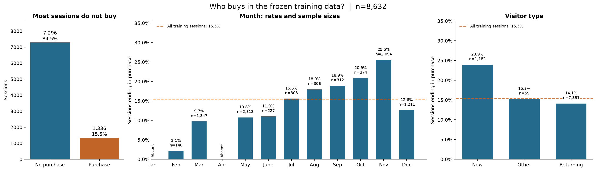
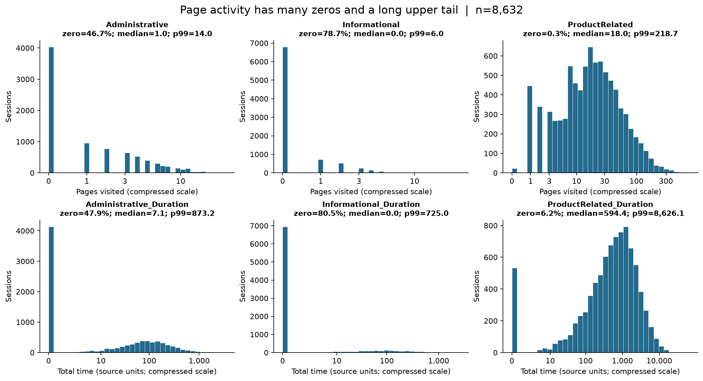
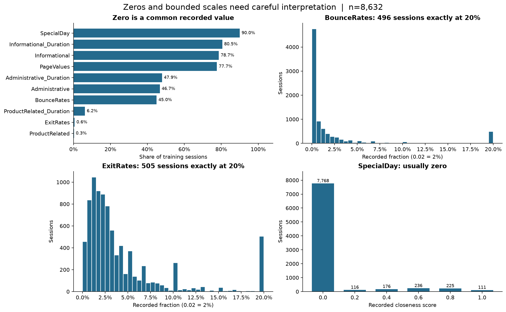
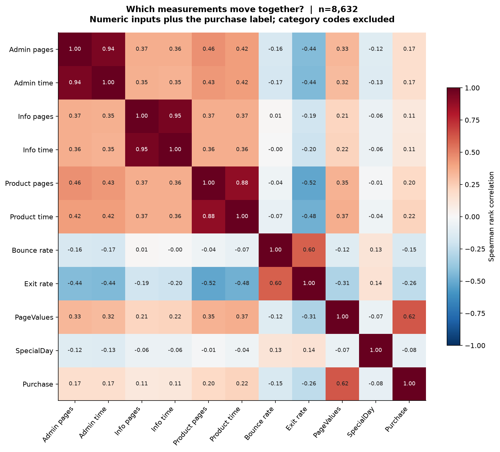
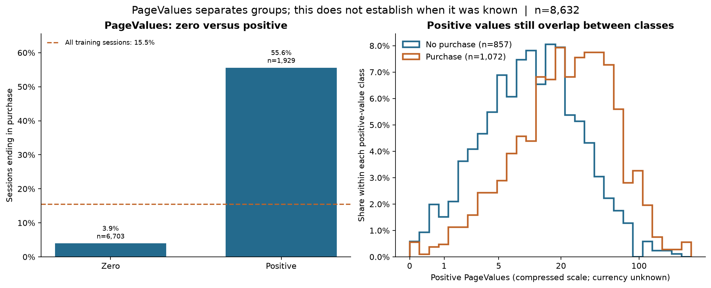

# What the training sessions tell us

This analysis asks what patterns a purchase classifier will encounter and what 
a future application could measure. It uses the **8,632 frozen training sessions**, 
including **1,336 purchases**. The source audit already checked the complete CSV;
all numbers and figures below are recalculated on training rows only. Validation
and test rows do not contribute to these summaries or plots.

The main picture is a site where most sessions do not buy, many sessions never
use particular page types, and a few sessions have much more activity than the
rest. PageValues is strongly associated with purchasing, but reproducing that
measurement on another site is an unresolved practical question.

## Start with who buys



**Figure 1.** The left panel counts sessions; the other panels show the fraction
of sessions ending in purchase. Every rate has its sample size (`n`), and the
dashed line marks the overall training purchase rate of **15.48%**. The bars are
descriptive rates, not model predictions or estimates of a causal effect.

There are **7,296 non-purchases**. Always answering “no purchase” would therefore
be correct 84.52% of the time while finding no buyers. That supports PIP-03's
decision to focus on purchase average precision and report precision and recall
alongside accuracy. This observation does not yet tell us whether class weights
or any other imbalance treatment will improve a model.

November has **535 purchases among 2,094 sessions (25.55%)**, compared with
**249/2,313 in May (10.77%)**. February has only **3/140 (2.14%)**. January and
April are absent, rather than months with a measured 0% purchase rate. The
sample sizes are uneven, and there is no year or exact timestamp to separate
calendar effects from changes in visitors or campaigns. Month may help within
this dataset; these bars do not demonstrate next year's seasonal pattern.

New visitors buy more often here: **283/1,182 (23.94%)**, compared with
**1,044/7,391 returning visitors (14.13%)**. Returning visitors still account for
most purchases because there are so many more of them. `Other` has only
**9/59 (15.25%)**; one extra purchase would change that rate by about 1.7
percentage points. These differences should motivate evaluation across groups,
not a claim that changing someone's visitor status changes their intent.

## A typical session is very different from an extreme one



**Figure 2.** Each bar counts sessions in a range. The horizontal scales compress
large values using `log(1 + value)` while the tick labels show original values.
This keeps zeros and the entire upper tail visible together; equal distances
along these axes do not represent equal differences in page counts or time.
`p99` is the value at or below which about 99% of training sessions fall.

Administrative pages have a median count of **1**; informational pages have a
median of **0**. Product pages are used much more widely, with a median of
**18** and only **23 zero-count sessions**. A single bell-shaped distribution
would describe these inputs poorly: many observations sit at zero, followed by
a long tail of larger values.

| Duration | Median | 99th percentile | Maximum |
| --- | ---: | ---: | ---: |
| Administrative | 7.11 | 873.19 | 3,398.75 |
| Informational | 0.00 | 725.04 | 2,549.38 |
| Product-related | 594.38 | 8,626.14 | 63,973.52 |

Durations remain in the source's unspecified time units. The largest product
duration is more than seven times its 99th percentile. Source row **8071**
(zero-based data-row position) has the maximum for all three duration columns
and 449 product pages. This is worth tracing if event logs become available;
the CSV alone cannot distinguish sustained browsing, idle tabs or a measurement
problem. The three largest examples for each duration are saved in
[extreme_durations.csv](../results/eda/extreme_durations.csv).

For preprocessing, compare a zero-preserving `log1p` transform for counts and
durations, with scaling for a linear model. This is a candidate to assess in
training cross-validation, not a decision justified by a prettier histogram.
Tree models can use the original values as a comparison. Keep extreme sessions
unless there is evidence of an error; any learned cap or scale must be fitted
within each training fold.

## Zero does not mean missing



**Figure 3.** The upper-left panel summarizes zero shares. The other panels use
the recorded rate and score scales, with session counts on the vertical axes.

Informational duration is zero in **6,952 sessions (80.54%)**; administrative
duration is zero in **4,137 (47.93%)**. A zero page count is compatible with not
visiting that page type. A zero duration needs more care: **104 administrative,
160 informational and 511 product-related sessions** have a positive count but
zero corresponding duration. None has a zero count with positive duration.
We cannot infer the collection mechanism from those combinations. Preserve
both fields and the recorded zeros rather than turning them into missing values
or deleting those sessions. A “has any activity” indicator is another candidate
to assess within training CV.

BounceRates and ExitRates are stored as fractions: **0.02 means 2%**, not 0.02%.
Both range from **0 to 0.2** here. Respectively **496** and **505** sessions sit
exactly at 0.2. That pile-up suggests a measurement or processing boundary to
investigate, but it does not establish clipping or make 0.2 a universal maximum
for a future website. BounceRates is zero for **44.98%** of sessions, whereas
ExitRates is zero for only **0.59%**.

SpecialDay is a closeness score, not a Boolean holiday flag. It takes six values
from 0 to 1 in steps of 0.2 and is zero for **7,768 sessions (89.99%)**. Do not
replace it with an invented holiday calendar or treat its many zeros as blanks.

## Which measurements move together?



**Figure 4.** Spearman correlation compares whether larger values tend to occur
together. Values near +1 mean a strong tendency to rise together, near -1 mean
opposite ordering, and near zero mean little such tendency. Tied zeros affect
these ranks. This summarizes associations; it cannot establish causation,
feature availability or model performance. Category codes are excluded because
their numbers do not represent meaningful distances or order.

Page counts and their durations largely describe overlapping activity:
correlations are **0.94 administrative, 0.95 informational and 0.88 product-related**.
BounceRates and ExitRates also move together (**0.60**). These relationships
motivate scaling and regularization for logistic regression rather than
automatically dropping one of each pair. Each may still add information when
combined with the other inputs.

Against the purchase label, PageValues has the largest numeric rank correlation
(**0.62**). Product duration has a smaller positive association (**0.22**), while
ExitRates is negative (**-0.26**). These are individual associations; they do not
rank a fitted model's feature importance or measure what happens after an input
is removed.

Some categorical inputs have very little evidence. Using **fewer than 20
training sessions** as a descriptive flag gives:

| Field | Code (training sessions) |
| --- | --- |
| OperatingSystems | 5 (4), 6 (13), 7 (6) |
| Browser | 9 (1), 11 (4), 12 (6) |
| TrafficType | 12 (1), 14 (8), 16 (3), 17 (1), 18 (6), 19 (13) |

For example, a purchase rate based on one browser session offers almost no
basis for generalization. Treat these codes as categories, provide an explicit
unseen-category path, and assess any rare-category grouping within training
folds. The 20-session flag is not a fitted grouping threshold. Complete category
counts and purchase rates, including Region and Weekend, are in
[categories.csv](../results/eda/categories.csv).

## PageValues is useful evidence, with an availability question



**Figure 5.** On the left, **264/6,703 zero-value sessions (3.94%)** end in a
purchase, compared with **1,072/1,929 positive-value sessions (55.57%)**. On the
right, only positive values are shown on a compressed horizontal scale. Each
class is normalized separately so its histogram sums to 100%; the legend gives
the class counts. Overlap remains: a positive value is neither a purchase label
nor a guarantee of purchase.

[UCI's variable information](https://archive.ics.uci.edu/dataset/468/online+shoppers+purchasing+intention+dataset)
describes Page Value as an average page value associated with pages visited
before a transaction. It identifies this and the bounce/exit metrics as Google
Analytics page metrics. That definition connects PageValues to transaction
history, but does not specify the calculation window, refresh time, or how page
metrics were combined into the released session rows.

A value derived only from earlier transactions might be available before the
current session's outcome. A value recomputed using that session's purchase or
later activity might not be. The CSV has no event timeline or calculation log
to decide between these possibilities. **This is an availability and timing
risk, not proven label leakage.** Strong association alone does not resolve it.

Compare all 17 inputs with the same sessions and folds after removing
PageValues; optionally remove bounce/exit rates as well. The explicit lists,
expected input types and app handling are in
[feature_availability.md](feature_availability.md) and
[src/feature_sets.py](../src/feature_sets.py). The 14-input version still needs
compatible collection rules and a defined prediction time; fewer analytics
inputs do not by themselves establish real-time readiness.

## Reproduce and carry the findings forward

From the repository root, after activating the existing environment:

```bash
python -m src.explore_training_data
python -m unittest discover -s tests
```

No notebook or new dependency is required. The reusable script saves five
figures, ten CSV tables, feature lists and a provenance record in `results/eda/`.
These small PIP-04 outputs are explicitly retained by `.gitignore`; other
generated results remain ignored. `--output-dir <directory>` writes a separate
copy. The script can run from another directory with `python -m` when the repo
is on the Python import path; its default source/output locations follow the
repository, not the current directory.

[provenance.json](../results/eda/provenance.json) records the source and training
manifest checksums, scope and library versions. The existing split loader first
checks the whole bundle for integrity; after selecting training indices, all
analysis functions receive only those rows. Source bytes and split assignments
are preserved. The tests cover this training boundary, feature-list contracts
and summary calculations.

The next preprocessing work should preserve meaningful zeros, handle unseen
categories, and compare ways of reducing the influence of long numeric tails.
Any fitted transformations belong inside the frozen training folds. No
preprocessing has been fitted and no models, thresholds or held-out performance
have been evaluated in this issue. Random session splits also leave future-period
and cross-site performance unestablished.
